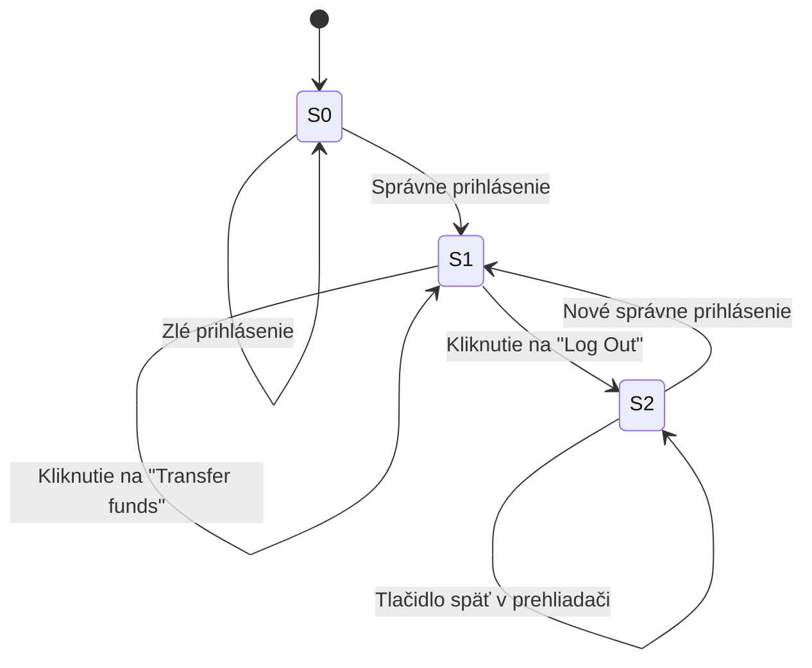

# Stavový model – prihlásenie a odhlásenie

## Stavy

- **S0** – neprihlásený
- **S1** – prihlásený
- **S2** – odhlásený

## Diagram

## Prechody

| ID | Východiskový stav | Udalosť | Očakávaný nový stav a správanie |
|---|---|---|---|
| 1 | S0 | Správne prihlásenie | S1 |
| 2 | S0 | Zlé prihlásenie | S0 |
| 3 | S1 | Kliknutie na „Transfer funds“ | S1 |
| 4 | S1 | Kliknutie na „Log Out“ | S2 (= S0) |
| 5 | S2 | Tlačidlo späť v prehliadači | Chránená stránka sa nezobrazí s dátami (alebo požiada o prihlásenie) |
| 6 | S2 | Nové správne prihlásenie | S1 |

## Pokrytie prechodov testami

| Prechod | Testovací prípad |
|---|---|
| 5 | [TC-032](test-records/TC-032.md) |
